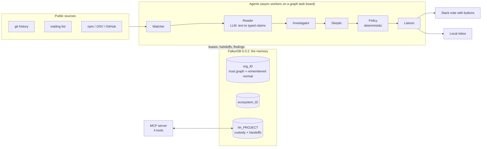
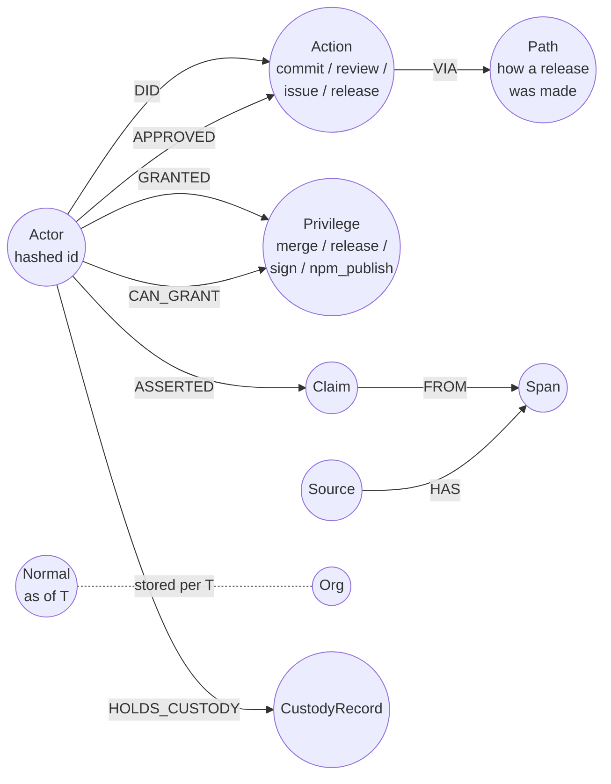

# Hearthguard

> **Some attacks are too slow for anything that forgets.**
> Hearthguard is a graph memory, built on FalkorDB, of who can change an open-source project and how that trust changed over time. Plain, tested code reads slow takeover moves from that memory and warns the person in charge before the last step.


-FF4438)


---

## Why this exists

The xz backdoor (2024) was not a single bad commit. It took about two years. A new contributor built trust slowly, sock-puppet accounts pressured a tired lone maintainer to hand over the keys, and the final payload went out through a release path that differed from the usual one. Each step looked normal on its own. You only see the pattern if you **remember what normal looked like at every point in time**.

Hearthguard is that memory. It stores who holds the keys, how fast trust was granted in the past, and what "normal" looked like at each quarter-end, as a time-aware graph. It reads four slow moves and one multiplier from it:

| Move | What it looks for |
|---|---|
| **Pressure** | Low-history accounts pushing a maintainer to hand over control |
| **Vouch** | Low-history accounts vouching for each other or for a newcomer |
| **Rush** | Trust granted much faster than this project's remembered normal |
| **Bypass** | A release made through a path that differs from the remembered usual path |
| **Lone keeper** (multiplier) | Only one person could stop it |

**The LLM is never in the decision path.** A language model only reads mailing-list text into typed claims, each backed by an exact quote. Detectors, the decision policy, takeover cost and guardians are deterministic code with unit tests (docs/HEARTHGUARD.md §8.4).

**Hearthguard asks; it never orders.** Under the Action Boundary (§4.4) it never blocks a release or a payment. It warns and recalls, in a private note with the evidence attached.

---

## Results at a glance

Every number has a source file in `eval/results/`. Where a result is unflattering, it is shown as it is.

| What | Result | Source |
|---|---|---|
| **Memory matters (ablation, 100 planted campaigns)** | Full memory catches **93 of 100**. Remembering only 90 days: 82. Only 30 days: 60. On 20 clean histories, full memory flags **1 of 20**; both forgetful versions flag **20 of 20** | `ablation_memory.json` |
| Red team, synthetic `tallowdate` project, 200 campaigns | 182 caught (0.91), median lead time 12.8 days | `redteam_tallowdate.json` |
| Red team, campaigns planted into a copy of real xz history | 167 of 200 caught (0.835), median lead time 11.0 days | `redteam_xz.json` |
| Agent coordination race test | 8 workers, 200 tasks, **0 duplicate claims**, 40 notes for 40 findings | `race_run.json` |
| Determinism | Identical findings under 5 different task orderings | `determinism_run.json` |
| Fault injection | All 9 failure types, including "LLM offline", end in a bounded HOLD | `faults_run.json` |
| Learning gate | A learned "ignore this" rule loses **0 of 200** planted attacks and **0 of 22** real-case detections | `learning_verify.json` |
| Ecosystem visibility | 22 visibility gaps across 4 downstream decisions | `ecosystem_gaps.json` |
| event-stream replay (2018) | First NOTE 7.1 days **after** the malicious release, 64.1 days **before** the public report | `replay_event_stream.json` |
| Real xz, per quarter | **HOLD in all 10 quarters**: the public record has no grant of release rights, so Rush and Bypass cannot be computed | `decision_status.json`, `xz_grant_search.json` |

**What we do not claim:** Hearthguard does **not** detect the xz backdoor. The backdoor was in the release tarballs, not in git, and no public record shows who was given release rights. We report that as NOT COMPUTED instead of guessing. The red-team numbers are on synthetic or planted campaigns. They show the detectors work as designed, not how often a real project would be flagged.

---

## How it works



1. **Ingest.** Public history is loaded into `org_<id>`. Every identifier is hashed on ingest.
2. **Remember normal.** At each time `T`, Hearthguard stores a `Normal` node: release cadence, active keepers, usual release path, and how long a grant of trust usually takes.
3. **Detect as of T.** Every detector takes `T` and reads only data at or before `T` (`core/graph/as_of.py`), so a replay can never see the future.
4. **Coordinate through the graph.** Agents claim tasks with leases, stale results are rejected, and one finding produces exactly one note (`core/board/board.py`). Handoffs between agents are graph nodes, not prompt text.
5. **Warn, don't block.** The Liaison writes a private note with the evidence. In Slack, the person can click *Show me why*, *Simulate a fix*, *Draft a reply*, *It's fine*, or *Remind me in a week*.

---

## Quickstart (2 minutes, no key, no database)

```powershell
uv sync
uv run python -m eval.demo
```

This prints the xz replay table, the visibility gaps, the hardening summary and the synthetic `tallowdate` summary from the saved result files.

## Full setup

A judge needs **no API key** for any step below.

1. Install [`uv`](https://docs.astral.sh/uv/) and Docker. For the UI, also Node and npm.
2. `uv sync`
3. Create `.env` in the repo root with `HEARTHGUARD_HASH_SALT=<any long random text>`. `.env` is git-ignored, and `.env.example` lists the variable names. Hashing refuses to run without the salt.
4. Start the database: `docker compose up -d`. On Windows you can also run `powershell -ExecutionPolicy Bypass -File .\make.ps1 up`. The image is pinned to `falkordb/falkordb:6.0.2`. If a port is taken, set `FALKORDB_PORT` or `FALKORDB_UI_PORT` in `.env`.
5. Run the tests: `uv run pytest -q`. The last run on main's code gave `1075 passed, 1 xfailed`. Tests that need git-ignored data (`data/raw/`) skip with a reason.
6. Run the memory demo: `uv run python -m demo.custody_demo`. It writes a custody baseline on Day 1, closes the app, then recalls it on Day 4 in a new session.

On Windows without `make`, every target below runs as `powershell -ExecutionPolicy Bypass -File .\make.ps1 <target>`. A plain `.\make.ps1` fails on a default Windows install, because the default execution policy is Restricted. For the judge path with expected outputs, see [docs/judge_guide.md](docs/judge_guide.md).

---

## Graph data model

FalkorDB 6.0.2 holds all of the core logic. No secondary datastore holds any. The schema and its unique keys are in `core/graph/schema.py`, and every write is an idempotent `MERGE` on a unique key (§6.6).

### Graphs

| Graph name | What it holds |
|---|---|
| `org_<id>` | One per organisation: the trust graph, remembered normal, claims, agent state |
| `ecosystem_<id>` | Who downstream could have seen a signal: places, roles, decisions |
| `hh_<project_slug>` | Per-project memory: custody records and agent handoffs. Every read and write names its project; there is no shared default graph |
| `redteam_<run>`, `harden_<run>`, `takeover_<run>` | Scratch copies made with `GRAPH.COPY` and dropped after each run |

### Core schema



| Layer | Nodes | Edges | Code |
|---|---|---|---|
| **Trust graph** | `Org`, `Actor` (hashed id), `Action`, `Path`, `Privilege` | `DID`, `VIA`, `GRANTED`, `CAN_GRANT`, `APPROVED` | `core/graph/schema.py` |
| **Remembered normal** | `Normal` (`cadence_days`, `active_keepers`, `usual_path`, `grant_days`), one per time `T` | | `core/normal/metrics.py` |
| **Claim graph** | `Source`, `Span`, `Claim` | `Source -[HAS]-> Span <-[FROM]- Claim <-[ASSERTED]- Actor` | `core/claims/graph_write.py` |
| **Agent coordination** | `Task`, `Finding`, `Note`, `AgentStep`, `Hardening`, `Exception` (the playbook), `OwnerDecision` | `OwnerDecision -[ABOUT]-> Finding` | `core/board/board.py` |
| **Per-project memory** | `CustodyRecord`, `Handoff` (`from_agent`, `to_agent`, `project`, `finding_id`, `summary`, `created_at`, `status`) | `HOLDS_CUSTODY`, `GRANTED` | `core/memory/custody.py`, `core/memory/handoff.py` |
| **Ecosystem** | `Place`, `Identity`, `Role`, `Signal`, `Decision` | `EMITTED`, `RECORDED_IN`, `WATCHES`, `PARTICIPATES_IN`, `MADE_IN`, `SAME_AS` | `packs/oss/ecosystem/graph.py`, `core/memory/who_saw.py` |

Every synthetic entity carries `synthetic: true`. Planted entities also carry `planted: true` and a `campaign_id`. **Detectors never read these flags; only the scorer does.**

### Queries and algorithms the product depends on

Every Cypher constant, with the module that runs it, is generated into [docs/queries.md](docs/queries.md). A test fails if that file is stale.

- **`algo.SPpaths`** over `OUTSIDER_ENTRY`, `CAN_GRANT`, `GRANTED` computes **takeover cost**: the cheapest way in for an outsider (`core/takeover/cost.py`). Run over `VOUCHED_FOR`, `REVIEWED`, `GRANTED`, it gives the **trust path** (`core/takeover/trust_path.py`).
- **`algo.maxFlow`** on a node-split projection computes **guardians**: how many people stand between an outsider and the keys (`core/takeover/guardians.py`). It takes exactly one relationship type.
- **Time-filtered reads** (`run_as_of`, `core/graph/as_of.py`) and the checked read path (`ro_query`, `core/graph/ro_guard.py`) go through `GRAPH.RO_QUERY`. Each has an explicit timeout, a block on write keywords, and a `LIMIT` cap.
- **Vouch components** are computed by plain code over graph reads (`core/detectors/vouch.py`).
- The task board, the playbook and claim writes use the write-capable client, also with an explicit timeout (`core/graph/client.py`).

---

## Agents, handoffs, MCP and Slack

- **Task board in the graph.** Workers claim `Task` nodes with leases. An expired lease is re-claimable, and a stale result is rejected. See the race test and the determinism test above.
- **Persistent handoffs.** `write_handoff` / `read_handoffs` store `Handoff` nodes in `hh_<project>`. One process can write a handoff and a separate process can read it later (`tests/unit/test_handoff.py`).
- **MCP server** (`mcp_server/server.py`, official Python MCP SDK, stdio) has 4 tools: `list_claims(project)`, `write_handoff(...)`, `read_handoffs(agent, project)`, `recall_custody(project)`. Any MCP client can read and write the same memory the agents use.
- **Slack.** The listener (`slack_app/listener.py`) serves `/slack/events` (including Slack's URL verification) and `/slack/actions`. On 2026-10-18 a live note was sent to our own test workspace, and its *Show me why* button was clicked through a Cloudflare quick tunnel. The listener logged `POST /slack/actions 200` within one second, and the bot replied in the thread. Only that one button was clicked live. The listener does not check Slack's request signature yet.

---

## Commands

Each name works as `make <name>`, or on Windows as `powershell -ExecutionPolicy Bypass -File .\make.ps1 <name>`. Positional arguments work, for example `.\make.ps1 replay xz`. The red team is `.\make.ps1 redteam -N 200 -Seed 7 -Case tallowdate`; N and the seed default to 200 and 7.

| Command | What it does | Needs |
|---|---|---|
| `uv run python -m eval.demo` | Print the xz replay table, the visibility gaps, the hardening summary and the tallowdate summary (synthetic, labelled) | files only |
| `uv run python -m demo.custody_demo` | Day 1 write, app closed, Day 4 recall across sessions; warns and recalls, never blocks (§4.4) | FalkorDB |
| `up` / `down` | Start or stop FalkorDB | Docker |
| `test` | Run the test suite | uv; FalkorDB and `.env` for the full suite |
| `lint` | ruff check and format check | uv |
| `smoke-algos` | Re-check each FalkorDB procedure the product depends on | FalkorDB |
| `ingest-xz`, `normal-xz`, `takeover-xz`, `detectors-xz`, `pressure-vouch-xz`, `quarterly-xz` | Build `org_xz` from the public xz git history and run the detectors at each quarter-end | FalkorDB; fetches the public xz git history into `data/raw/xz.git` if it is absent (network) |
| `decision-xz` | The decision policy on the saved statuses | files only |
| `replay CASE=xz` | Rewrite `eval/results/xz_replay.json` and `.md` from saved files | files only |
| `ecosystem-xz`, `gaps CASE=xz` | Load `ecosystem_xz` and compute the visibility gaps; print them (roles only) | network, FalkorDB; files only for `gaps` |
| `tallowdate-run` | The synthetic tallowdate history, load to demo script | FalkorDB, `.env` |
| `redteam N=200 SEED=7 CASE=tallowdate` | Plant N campaigns into copies of a case graph and score the frozen detectors | FalkorDB |
| `harden CASE=xz` | Each hardening step on a copy of the case graph, the same campaigns. Slow: about 38 minutes at the default N=200 | FalkorDB |
| `uv run python -m eval.ablation_memory` | Full vs forgetful memory (last 90 / 30 days) on the same campaigns | FalkorDB, tallowdate loaded |
| `uv run python -m eval.ablation_algos` | Vouch components, SPpaths and maxFlow off one at a time | FalkorDB, tallowdate loaded |
| `uv run python -m eval.incidents_fetch` | Cache the public event-stream and axios records (npm registry, OSV, GitHub issues) | network |
| `uv run python -m eval.incidents_load` | Load them into `org_event_stream` and `org_axios`, twice, and check the counts | FalkorDB |
| `uv run python -m eval.replay_event_stream`, `uv run python -m eval.replay_axios` | Replay the two incidents with the frozen detectors | FalkorDB, incidents loaded |
| `uv run python -m eval.verify_packs` | The finance case runs with the OSS pack removed | FalkorDB |
| `queries` (`uv run python -m eval.queries_doc`) | Rewrite `docs/queries.md` from the query constants in the code | files only |
| `ui` | Read-only page at http://localhost:5173 | Node, npm |
| `inbox` | The local inbox at http://127.0.0.1:8765/#/inbox, the same note and thread as Slack | Node, npm |
| `uv run python slack_app/listener.py --port 3008` | The Slack listener (`/slack/events`, `/slack/actions`, `/slack/health`) | `SLACK_BOT_TOKEN` for replies |
| `llm-test`, `reader-spotcheck`, `reader-full` | The Reader through Groq | **needs a key** (`GROQ_API_KEY`) |

Every command in this table was run in a clean clone of main without a key and exited 0, except these:

- **Need a key, so not run:** `llm-test`, `reader-spotcheck`, `reader-full`.
- **Servers that do not exit, so not run:** `ui`, `inbox`, and the Slack listener.
- **Not run on purpose:** `down`.

The exit codes and notes are in docs/fresh_clone_report.md. Targets that the spec lists but that are not wired are listed in `eval/results/makefile_gaps.md`.

---

## Honest limits

- **Real xz detection is NOT COMPUTED.** We searched 14 sources and found 0 grant records (`xz_grant_search.json`). So takeover cost, Rush, Bypass and Lone keeper cannot be computed on xz, and the decision is HOLD in all 10 quarters.
- **The Reader read 230 of 240 in-scope messages.** Ten were not read: 9 were too long and 1 returned no valid JSON (`reader_full_run.json`, `pressure_vouch_status.json`). A NOT_FIRED result covers only the messages that were read.
- **Most raw claims fail the quote check.** 12 claims were kept and 26 rejected, because their quote was not an exact substring of the message. That check is deliberate: no quote, no claim.
- **Reader precision and recall are NOT COMPUTED.** The human-labelled test set is kept blinded and has no labels yet.
- **The frozen Bypass detector remembers 730 days.** A two-year gap (event-stream) or a recent change of normal (axios) defeats it, and the replays show both cases. In the axios replay, Bypass did not fire: 33 of the 37 releases in the trailing 730 days were manual publishes.
- **Hardening has an unexplained result.** Adding a second keeper raises guardians from 1 to 2 but lowers the number of caught campaigns from 167 to 152 of 200. This build does not explain that drop (`hardening_redteam_xz.json`).
- **Google Cloud spend has an unexplained cause.** The ₹16.31 spend on the Gemini run is not broken down by cause.
- **Completion:** 77 of 131 spec rows are DONE and 33 are PARTIAL (`eval/results/completion_full.md`). Every open decision is in `docs/decisions/index.md`.
- **Deployment:** local only. Nothing is hosted.

### Act II is synthetic

Act II, the `tallowdate` case, is a fictional project. It is labelled SYNTHETIC wherever it appears (§3.5; `uv run python -m redteam.run_tallowdate`). The Northbridge finance case is also synthetic.

### Data and privacy

Only public, synthetic or our own data is used. Identifiers are hashed on ingest, and no per-project findings are published. Every fetch is cached to `data/raw/` with its URL and fetch time, and `data/raw/` is git-ignored.

---

## Repository layout

| Path | What is there |
|---|---|
| `core/` | Graph client, as-of-T reads, detectors, normal, takeover cost, guardians, task board, claims, memory, policy |
| `packs/` | Domain packs (OSS ecosystem) |
| `redteam/` | Campaign generator, scorer, hardening runner |
| `eval/` | Evaluation scripts; every result is written as JSON to `eval/results/` |
| `slack_app/` | Slack sender, listener, note rendering, wording rules |
| `mcp_server/` | MCP server (4 tools) |
| `demo/` | Custody demo and the static demo page |
| `ui/` | React + Vite + TypeScript read-only UI and inbox |
| `tests/` | Unit and integration tests; integration tests use a real FalkorDB container, never mocks |

## AI disclosure

- An AI coding assistant wrote most of the code and tests under the owner's direction. Each AI-assisted step is logged in [docs/AI_USE.md](docs/AI_USE.md).
- A second AI model gave a blind second opinion on the test-set labels. It is labelled as an AI opinion everywhere it appears.
- The Reader calls `openai/gpt-oss-20b` through Groq and a Gemini model through Google, for claim extraction only. No other product code calls an LLM.

## Track

**Track 02: Agent Memory and Coordination**, FalkorDB hackathon (https://www.wemakedevs.org/hackathons/falkordb).

## Docs

- Judge guide: [docs/judge_guide.md](docs/judge_guide.md)
- Cypher queries, generated from the code: [docs/queries.md](docs/queries.md)
- Spec: [docs/HEARTHGUARD.md](docs/HEARTHGUARD.md)
- Decisions: [docs/decisions/index.md](docs/decisions/index.md)
- AI use log: [docs/AI_USE.md](docs/AI_USE.md)
- Project rules: [CLAUDE.md](CLAUDE.md)
